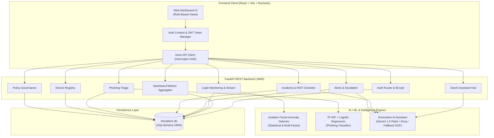
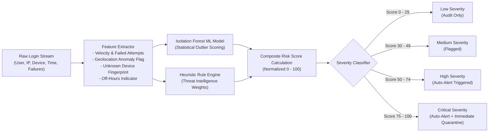
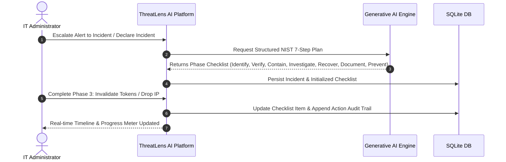
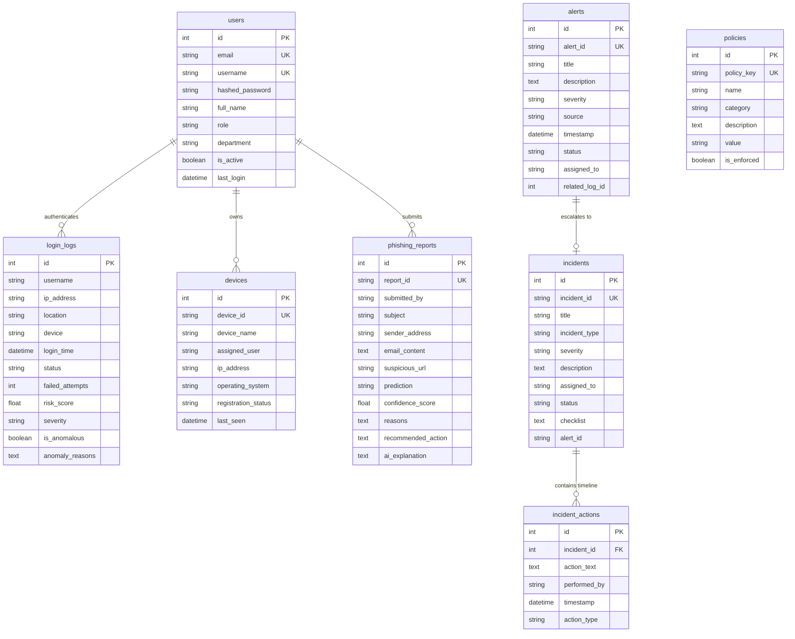

# ThreatLens AI – System Architecture & Technical Specification

ThreatLens AI is an AI-powered cybersecurity monitoring and incident management platform engineered specifically for colleges, universities, and small-to-medium organizations without dedicated 24/7 Security Operations Centers (SOC).

---

## 1. High-Level System Architecture

---

## 2. Machine Learning Anomaly Detection Pipeline

---

## 3. Incident Response NIST 7-Phase Workflow

---

## 4. Entity-Relationship Diagram (ERD)

